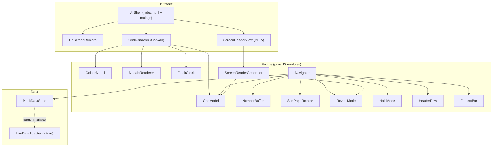
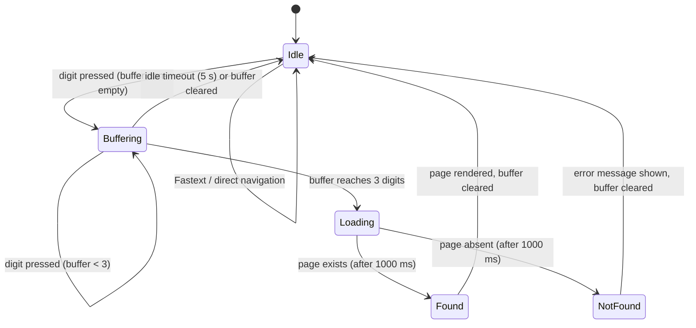

# Design Document

## Overview

Page 100 is a browser-based teletext emulator that faithfully recreates the classic British teletext
experience as a self-contained static web application. It renders a 40-column × 25-row character
grid at a 4:3 aspect ratio, supports eight classic teletext colours, mosaic block graphics,
double-height and flashing text, page navigation by digit entry and Fastext coloured links,
sub-page rotation, a Reveal feature for hidden text, and a live ticking clock in the header.

The system is built entirely in TypeScript with no runtime framework dependencies, so the core
engine is importable in Node.js for testing. A thin HTML/CSS shell hosts the canvas-based grid
renderer and the on-screen remote control. All page content is supplied by a mock data store;
swapping in a live data adapter requires no changes to the engine.

---

## Architecture

### High-Level Component Diagram



### Module Boundaries

| Module | Responsibility | Browser API dependency |
|---|---|---|
| `GridModel` | Cell storage and access | None |
| `ColourModel` | Colour name↔RGB mapping and validation | None |
| `MosaicRenderer` | Sixel bitmask ↔ character code encoding/decoding | None |
| `FlashClock` | Shared 1 Hz flash timer, subscriber list | None (uses `Date.now()`) |
| `NumberBuffer` | Accumulate/clear 1–3 digit input | None |
| `Navigator` | State machine: idle → loading → found/not-found | None (async via injected timer) |
| `SubPageRotator` | 15 s rotation timer, hold/resume | None (injected timer) |
| `RevealMode` | Boolean mode flag + cell render policy | None |
| `HoldMode` | Boolean mode flag | None |
| `HeaderRow` | Compose row-0 cell data from engine state | None |
| `FastextBar` | Compose row-24 cell data from page data | None |
| `ScreenReaderGenerator` | Convert Grid rows to plain-text strings | None |
| `GridRenderer` | Draw grid onto HTML `<canvas>` | Canvas 2D API |
| `OnScreenRemote` | Render remote control, relay events | DOM |
| `MockDataStore` | Provide `PageDataProvider` interface | None |

All engine modules (above the `GridRenderer` line) are TypeScript modules, framework-free, and importable in Node.js.

---

## Components and Interfaces

### GridModel

```ts
interface Cell {
  char: number;           // Unicode code point (0x20 = space)
  fg: ColourName;         // foreground colour
  bg: ColourName;         // background colour
  mosaic: boolean;        // render as mosaic
  doubleHeight: boolean;  // scale character to 2 rows
  flash: boolean;         // apply 1 Hz flash
  concealed: boolean;     // hidden unless Reveal_Mode active
}

interface GridModel {
  getCell(row: number, col: number): Cell;
  setCell(row: number, col: number, cell: Partial<Cell>): void;
  reset(): void;              // fill all cells with default Cell values
  readonly rows: 25;
  readonly cols: 40;
}
```

Row indices: 0–24. Column indices: 0–39. Reading or writing out-of-range coordinates throws a
`RangeError`.

### ColourModel

```ts
type ColourName = 'black' | 'red' | 'green' | 'yellow'
                | 'blue'  | 'magenta' | 'cyan' | 'white';

interface ColourModel {
  toRGB(name: ColourName): string;        // returns '#RRGGBB'
  isValid(name: string): name is ColourName;
}
```

Fixed mapping (no runtime configuration):

| Name | RGB |
|---|---|
| black | #000000 |
| red | #FF0000 |
| green | #00FF00 |
| yellow | #FFFF00 |
| blue | #0000FF |
| magenta | #FF00FF |
| cyan | #00FFFF |
| white | #FFFFFF |

### MosaicRenderer

```ts
interface MosaicRenderer {
  /**
   * Decode character code → 6-bit bitmask (bits 0–5, row-major).
   * Throws RangeError for codes outside 0x20–0x3F and 0x60–0x7F.
   */
  decode(charCode: number): number;

  /**
   * Encode 6-bit bitmask → character code in the contiguous mosaic set.
   * Throws RangeError for bitmask values outside 0–63.
   */
  encode(bitmask: number): number;

  /**
   * Return the six sub-block active states for a given bitmask as an array
   * of booleans in row-major order [topL, topR, midL, midR, botL, botR].
   */
  subBlocks(bitmask: number): [boolean, boolean, boolean, boolean, boolean, boolean];
}
```

**Bitmask encode/decode formulas:**

```
decode(code):  mask = (code & 0x1F) | ((code & 0x40) ? 0x20 : 0)
encode(mask):  code = 0x20 | (mask & 0x1F) | ((mask & 0x20) ? 0x40 : 0)
```

Bit positions: bit 0 = top-left, bit 1 = top-right, bit 2 = middle-left, bit 3 = middle-right, bit 4 = bottom-left, bit 5 = bottom-right.

Valid input ranges:
- `decode`: character codes 0x20–0x3F and 0x60–0x7F; throws `RangeError` for anything else.
- `encode`: bitmask values 0–63; throws `RangeError` for anything outside this range.

The six sub-blocks are painted at rendering time by `GridRenderer`; `MosaicRenderer` only
handles the pure encoding/decoding logic.

### FlashClock

```ts
interface FlashClock {
  /** Current phase: true = character visible, false = character hidden */
  readonly phase: boolean;
  /** Subscribe; callback fired at every phase transition */
  subscribe(cb: (phase: boolean) => void): () => void;
  /** Start the clock (called once when a page is first displayed) */
  start(): void;
  /** Stop and reset phase to true */
  stop(): void;
}
```

Implemented with `setInterval(500)` internally. All flashing cells on the same page share one
`FlashClock` instance, ensuring synchronised transitions within ±20 ms.

### NumberBuffer

```ts
interface NumberBuffer {
  readonly digits: string;   // '', '1', '12', or '123'
  append(digit: string): boolean;   // returns false if already 3 digits
  backspace(): boolean;             // returns false if already empty
  clear(): void;
  readonly isFull: boolean;         // true when digits.length === 3
  readonly isEmpty: boolean;
}
```

A 5-second idle timer is managed by `Navigator`, not `NumberBuffer` itself, keeping the buffer
a pure data structure.

### Navigator

The Navigator is a finite-state machine with the following states and transitions:



```ts
type NavState = 'idle' | 'buffering' | 'loading' | 'found' | 'not-found';

interface Navigator {
  readonly state: NavState;
  onDigit(d: string): void;
  onBackspace(): void;
  navigateTo(pageNumber: number): void;   // Fastext / programmatic
  readonly currentPage: number;
  readonly currentSubPage: number;
}
```

During the `loading` state the Navigator awaits `PageDataProvider.getPage()`. The loading state
lasts at least 1000 ms (±100 ms) regardless of how quickly the provider resolves, so the
searching animation always plays. If the provider resolves faster, the Navigator waits for the
remaining time before transitioning to `found` or `not-found`.

### SubPageRotator

```ts
interface SubPageRotator {
  start(totalSubPages: number): void;
  stop(): void;
  hold(): void;
  resume(): void;
  readonly currentIndex: number;    // 0-based
  readonly isHeld: boolean;
  onAdvance: (index: number) => void;  // callback
}
```

Advances every 15 000 ms via `setInterval`. Wraps from last back to 0.

### PageDataProvider (interface for both Mock and Live)

```ts
interface PageData {
  number: number;
  subPages: SubPageData[];
  fastextLinks: {
    red?:    { page: number; label: string };
    green?:  { page: number; label: string };
    yellow?: { page: number; label: string };
    cyan?:   { page: number; label: string };
  };
}

interface SubPageData {
  index: number;        // 1-based (1/N)
  total: number;        // N
  cells: Cell[][];      // [25][40]
}

interface PageDataProvider {
  getPage(number: number): Promise<PageData | null>;
  listPages(): Promise<number[]>;
}
```

`MockDataStore` and any future live adapter both implement `PageDataProvider`.

### GridRenderer

Renders the `GridModel` onto an HTML `<canvas>` element.

- Uses the public-domain "Bedstead" teletext font, bundled locally in the repo under `public/fonts/bedstead.woff2` (no CDN dependency).
- Falls back to `monospace` if the font fails to load.
- The font is loaded via a `@font-face` declaration in the CSS; `GridRenderer` waits for `document.fonts.ready` before first render.
- Cell size in pixels: computed as `Math.floor(canvasWidth / 40)` × `Math.floor(canvasHeight / 25)`;
  both are whole-pixel integers.
- The canvas backing store is scaled by `window.devicePixelRatio`: the canvas `width` and `height` attributes are set to `cssWidth * dpr` and `cssHeight * dpr`, while the CSS `width` and `height` remain at the CSS pixel values. The 2D context is scaled by `ctx.scale(dpr, dpr)` after each resize so that all draw calls use CSS-pixel coordinates. This ensures crisp rendering on high-DPI (Retina) screens.
- Aspect ratio is enforced by CSS: the `<canvas>` element is sized with `max-width`/`max-height`
  keeping width ÷ height between 1.30 and 1.40. Letterboxing is applied by centering with
  flexbox on the outer container.
- Double-height cells: draw the glyph scaled ×2 vertically, then blank the row below.
- Mosaic cells: use `MosaicRenderer.subBlocks()` to get the six booleans, then `fillRect` for
  each sub-block.
- Flash: subscribe to `FlashClock`; on each phase change, re-render only flashing cells.

### ScreenReaderGenerator

```ts
interface ScreenReaderGenerator {
  generate(grid: GridModel, revealActive: boolean): string[];
}
```

Returns an array of non-empty trimmed strings, one per non-empty row, top-to-bottom. Mosaic
cells become `"[graphic]"`. Concealed cells become `" "` when `revealActive` is false, or their
decoded character when true. Colour and attribute codes are stripped.

### OnScreenRemote

DOM component (vanilla JS + CSS). Emits custom events that `main.js` forwards to `Navigator`.
Collapses/expands in response to its own toggle button. Repositions via CSS media query based
on viewport width.

---

## Data Models

### Cell (default values)

```ts
const DEFAULT_CELL: Cell = {
  char: 0x20,          // space
  fg: 'white',
  bg: 'black',
  mosaic: false,
  doubleHeight: false,
  flash: false,
  concealed: false,
};
```

### Mock Page Catalogue

| Page | Title | Sub-pages | Special content |
|---|---|---|---|
| 100 | Index | 1 | Mosaic logo (≥4×2 mosaic cells) |
| 101 | News Headlines | 2 | Double-height headlines |
| 150 | Quiz | 1 | ≥3 Q&A pairs; answers have `concealed: true` |
| 302 | Football Scores | 2 | Flashing score cells |
| 401 | Weather Map | 1 | Mosaic map (≥10 mosaic cells) |

Each mock page is defined as a plain JSON-serialisable object conforming to `PageData`.

### Header Row Layout (row 0)

| Columns | Content |
|---|---|
| 0–2 | Number_Buffer digits (or current page number if empty) |
| 3 | space |
| 4–11 | "PAGE 100" (service name, cyan on black) |
| 12 | space |
| 13–17 | Sub-page indicator ("M/N" or "HOLD" or blank) |
| 18–19 | space |
| 20–25 | Date "DD MMM" (white on black) |
| 26–31 | space |
| 32–39 | Clock "HH:MM:SS" (white on black) |

The clock is updated once per second via `setInterval(1000)` in `HeaderRow`.
The blinking cursor (columns 0–2 when buffer has 1 or 2 digits) uses a 500 ms toggle on a
dedicated interval.

### Fastext Bar Layout (row 24)

| Columns | Colour | Content |
|---|---|---|
| 0–9 | red on black | red link label (10 chars) |
| 10–19 | green on black | green link label (10 chars) |
| 20–29 | yellow on black | yellow link label (10 chars) |
| 30–39 | cyan on black | cyan link label (10 chars) |

The `FastextBar` reads `label` from `fastextLinks` for each colour, truncating or padding to
exactly 10 characters, and renders it in the link colour on black. If a link is undefined, the
10-character slot is rendered blank.

---

## Correctness Properties

*A property is a characteristic or behavior that should hold true across all valid executions of a system — essentially, a formal statement about what the system should do. Properties serve as the bridge between human-readable specifications and machine-verifiable correctness guarantees.*

### Property 1: Mosaic character round-trip

*For any* valid mosaic character code in the ranges 0x20–0x3F or 0x60–0x7F, encoding then
decoding (or decoding then encoding) SHALL produce the original character code unchanged.

**Validates: Requirements 3.2, 3.5, 14.5**

### Property 2: Mosaic sub-block count

*For any* valid mosaic character code, the number of active sub-blocks returned by `subBlocks()`
SHALL equal the number of set bits in the decoded bitmask.

**Validates: Requirements 3.1, 3.2, 3.5**

### Property 3: Invalid colour assignment is rejected

*For any* string that is not one of the eight named teletext colours, assigning it as a Cell's
foreground or background colour SHALL leave the Cell's existing colour values unchanged and SHALL
return or throw an error.

**Validates: Requirements 2.6**

### Property 4: NumberBuffer digit accumulation invariant

*For any* sequence of `append` calls with valid digits, the resulting `digits` string SHALL be a
prefix of the input sequence, its length SHALL never exceed three, and `isFull` SHALL be true if
and only if `digits.length === 3`.

**Validates: Requirements 7.1, 7.2**

### Property 5: NumberBuffer backspace is a left-inverse of append

*For any* non-empty `NumberBuffer` state produced by one or more `append` operations, calling
`backspace` once SHALL remove exactly the last appended digit and leave all prior digits unchanged.

**Validates: Requirements 7.8**

### Property 6: Grid Cell read/write round-trip

*For any* valid (row, col) coordinate and any Cell value, writing that Cell and immediately
reading it back SHALL produce a Cell equal to what was written, with all fields preserved.

**Validates: Requirements 1.6, 14.1**

### Property 7: Colour mapping is total and injective

*For any* of the eight named Colours, `toRGB` SHALL return the fixed RGB string defined in the
specification, and no two distinct named Colours SHALL map to the same RGB string.

**Validates: Requirements 2.1, 2.4**

### Property 8: Screen reader view strips attributes

*For any* Grid containing Cells with foreground/background colours, flash, double-height, mosaic,
or concealed attributes, the string produced by `ScreenReaderGenerator.generate()` for that
row SHALL contain no colour codes, attribute codes, or mosaic character codes — only plain
Unicode text, `"[graphic]"` placeholders, and spaces.

**Validates: Requirements 12.1, 12.2, 12.3**

### Property 9: Reveal mode does not modify concealed attribute

*For any* Grid containing Cells with `concealed: true`, calling `ScreenReaderGenerator.generate()`
with `revealActive = true` SHALL return the cells' stored characters, while calling it with
`revealActive = false` SHALL return spaces — in both cases the Cell's `concealed` field in the
GridModel SHALL remain `true`.

**Validates: Requirements 10.3, 10.5, 12.4, 12.5**

---

## Error Handling

| Error condition | Detection point | Behaviour |
|---|---|---|
| Grid access out of bounds | `GridModel.getCell` / `setCell` | Throw `RangeError` with coordinate details |
| Invalid colour name assigned to Cell | `GridModel.setCell` | Reject assignment, preserve existing colour, throw/return error |
| Mosaic code out of valid ranges | `MosaicRenderer.decode` | Throw `RangeError`; renderer falls back to fully-inactive mosaic |
| Mosaic bitmask out of 0–63 | `MosaicRenderer.encode` | Throw `RangeError` |
| Page not found on navigation | `Navigator` | Enter `not-found` state; display "Page not found" message in grid; clear buffer |
| Fastext link to non-existent page | `Navigator.navigateTo` | Stay on current page; display inline error message |
| Sub-page index out of range | `SubPageRotator` | Clamp to valid range; log warning (no user-visible crash) |
| Double-height cell on row 24 | `GridRenderer` | Render at single height; no overflow |
| Double-height on row N with row N+1 also double-height | `GridRenderer` | Ignore lower cell's double-height; render lower cell as blank |
| Clock/timer failure (tab hidden) | `HeaderRow`, `FlashClock` | Re-sync to `Date.now()` on next tick; no cumulative drift |

All public module methods that can fail throw typed errors (subclasses of `Error`) rather than
returning sentinel values, so callers can distinguish error types with `instanceof` checks.

---

## Testing Strategy

### Approach

The project uses a dual testing approach combining example-based unit tests and property-based
tests to achieve comprehensive correctness coverage.

- **Unit tests**: target specific examples, edge cases, error conditions, and integration between
  modules.
- **Property-based tests**: target universal properties across a large randomised input space.

Both suites run in Node.js with no browser dependency, using the engine's TypeScript modules (compiled by Vitest's native TS support).

### Tooling

| Tool | Purpose |
|---|---|
| [Vitest](https://vitest.dev/) | Unit and property test runner (ES module native) |
| [fast-check](https://fast-check.io/) | Property-based testing library |
| `@vitest/coverage-v8` | Line coverage reporting (≥80% target across engine modules) |

### Unit Test Coverage Targets

- `GridModel`: cell read/write, boundary errors, `reset()`.
- `ColourModel`: all eight colour mappings, rejection of invalid names.
- `MosaicRenderer`: valid codes in both ranges, invalid code rejection, sub-block layout.
- `NumberBuffer`: digit append, backspace, clear, full/empty flags, ignore-when-full.
- `Navigator`: all state transitions (idle → buffering → loading → found, idle → buffering → loading → not-found, Fastext navigation, idle timeout).
- `SubPageRotator`: advance, wrap, hold, resume.
- `RevealMode` / `HoldMode`: toggle, navigation reset.
- `ScreenReaderGenerator`: plain text extraction, mosaic placeholder, concealed cells, empty row omission.

### Property-Based Test Configuration

Each property test is configured to run a **minimum of 100 iterations** via `fast-check`'s `fc.assert(fc.property(...))`.

Each test is tagged with a comment in the following format:
```
// Feature: teletext-engine, Property N: <property_text>
```

The properties to implement as property tests correspond to the nine Correctness Properties
defined above:

| Test | Property | fast-check arbitraries |
|---|---|---|
| Mosaic round-trip | P1 | `fc.oneof(fc.integer({min:0x20,max:0x3F}), fc.integer({min:0x60,max:0x7F}))` |
| Mosaic sub-block count | P2 | same as P1 |
| Invalid colour rejection | P3 | `fc.string().filter(s => !VALID_COLOURS.includes(s))` |
| NumberBuffer accumulation invariant | P4 | `fc.array(fc.char().filter(c=>/[0-9]/.test(c)), {maxLength:10})` |
| NumberBuffer backspace inverse | P5 | `fc.array(fc.char().filter(c=>/[0-9]/.test(c)), {minLength:1,maxLength:3})` |
| Grid round-trip | P6 | `fc.record({row:fc.integer({min:0,max:24}), col:fc.integer({min:0,max:39}), cell:cellArbitrary})` |
| Colour mapping total and injective | P7 | `fc.constantFrom(...VALID_COLOURS)` |
| Screen reader strips attributes | P8 | `fc.array(cellArbitrary, {minLength:40,maxLength:40})` |
| Reveal mode preserves concealed attribute | P9 | `fc.boolean()` (revealActive) + grid with concealed cells |

### Integration Tests (Optional)

A small set of browser integration tests (using Playwright or similar) cover:
- Page 100 loads and renders on startup.
- Digit entry navigates to a valid page within 1 100 ms.
- Fastext key presses trigger correct navigation.
- Clock in header row increments each second.
- On-screen remote digits and Backspace are processed identically to keyboard.

These tests are not included in the required implementation tasks. They may be added as optional tasks. The required test suite is Vitest + fast-check only.
